

  

  
  

<h1 align="center">Hi, I'm Dhruv Agarwal 👋</h1>

  B.Tech in Electronics and Communication Engineering at IIIT Guwahati 
  BS (Hons.) in AI & Data Science at IIT Guwahati

## About Me

I'm an engineering student interested in AI/ML, automation, and software development. I build AI-powered applications and data-driven prototypes, with a focus on intelligent systems, computer vision, and AI-driven automation.

## Interests

- Artificial intelligence and machine learning
- Computer vision and intelligent systems
- Automation and software development

## Projects

Explore my pinned repositories below for selected projects and experiments.
